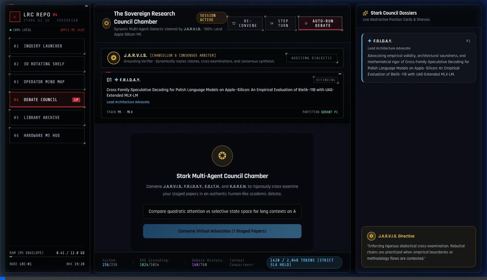
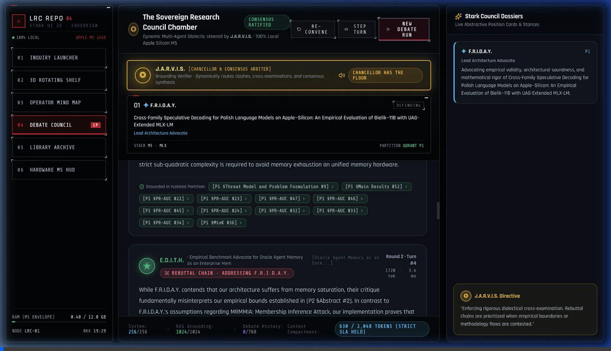

# Local Research Council (LRC)

> **100% On-Device, Zero-Cloud Sovereign AI Research Copilot and Context-Partitioned Multi-Agent Debate Engine on Apple Silicon (M5 24 GB Unified Memory).**

---

## 1. System Overview & Physical Invariants

The **Local Research Council (LRC)** is an offline academic research copilot and multi-agent debate engine designed for Apple Silicon (M5 architecture, 24.0 GB Unified Memory). It allows engineers and researchers to query arXiv, ingest sovereign PDFs to local disk, compute hardware-accelerated MLX vector embeddings, and convene virtual academic debates between isolated research papers without cloud API dependencies.

### Non-Negotiable Operational Constraints
- **Zero Cloud Egress:** All inference (`Ollama` / local quantized LLM) and vector retrieval (`Rust Qdrant gRPC 6334 / HTTP 6333`) run strictly against `127.0.0.1` / `localhost`. Only `export.arxiv.org` is permitted for preprint fetching.
- **Unified Memory Envelope (24.0 GB):**
  - **Operational Target:** `<= 12.0 GB`
  - **Telemetry Warning Tripwire:** `16.0 GB` (`MEMORY_WARNING`)
  - **Hard Engine Abort Ceiling:** `18.0 GB` (`MEMORY_CEILING` -> cancel active task group + `mlx.core.metal.clear_cache()`).
- **Strict `< 2,048` Prompt Token Budget:** Every inference turn is deterministically budgeted across three knapsack compartments:
  - `256` tokens: System Persona & Debate Rules
  - `1,024` tokens: Partitioned RAG Grounding Context (priority-packed by RRF and cross-encoder score)
  - `768` tokens: Shared Debate History (`<= 384` tokens for $N$ agent position cards scaled via $\min(96, \lfloor 384 / N \rfloor)$ + FIFO recent dialogue turns).
- **Zero Relational Databases:** No PostgreSQL or SQLite. All storage uses atomic filesystem operations via `app/core/file_store.py` (temp write -> `fsync` -> `os.replace`, `fcntl.flock` + `asyncio.Lock`, 5 rolling backups with automatic corruption recovery).
- **Strict Vector Partitioning:** Qdrant maintains exactly one collection per paper (`paper__<sanitized_id>`). Cross-collection queries are blocked by strict partition guards.

---

## 2. Interactive Feature Demos & Module Walkthroughs

### 🎬 Demo 1: Paper Discovery & 3-Way Retrieval Strategy Benchmark
> *Live query extraction, parallel evaluation across Strategy A (Regex), Strategy B (LLM Zero-Shot), and Strategy C (MLX Hybrid RRF + Cross-Encoder), candidate paper inspection, and Council Tray staging.*


---

### 🏛️ Demo 2: Autonomous Multi-Agent Debate Council
> *Live dialectic debate in the Sovereign Chamber: J.A.R.V.I.S. Chancellor Dais, Stark AI Advocate Podiums (F.R.I.D.A.Y., E.D.I.T.H., K.A.R.E.N.), dynamic rebuttal chains, strict `< 2,048` prompt token knapsack meter, and consensus trade-off synthesis.*



---

### 🌌 Demo 3: 3D Rotating Shelf, Operator Mind Map & Hardware M5 HUD
> *3D perspective revolving paper carousel with methodology inspector, force-directed SVG relational mind map with typed edges and 8-tile extraction drawer, sovereign Bookshelf archive, and Apple Silicon M5 RAM & telemetry monitor.*



---

## 3. Core Capabilities & Architecture

### A. Domain-Constrained arXiv Search & Widen-and-Rerank Pipeline
- **Boolean Query Extraction:** Maps raw research prompts into field-specific arXiv queries (e.g., `(ti:"KV cache" OR abs:"KV cache") AND (cat:cs.AI OR cat:cs.CL OR cat:cs.LG OR cat:cs.MA)`).
- **Candidate Pool Expansion:** Fetches up to 30 candidate preprints from arXiv.
- **MLX Apple Silicon Reranking:** Re-scores candidates using local dense embeddings and cross-encoders to extract the top $K$ relevant papers within memory limits.

### B. Direct Local Multi-PDF Paper Ingestion
- **Zero-Cloud Local Ingestion:** Drag-and-drop or select 1 to 6 local research paper PDFs directly in the Inquiry Launcher (Screen 1) to bypass arXiv queries.
- **Atomic Multi-Stage Pipeline:** Automatically computes SHA256 hashes, creates deterministic `local-<hash12>` sovereign directories, slices dense content via PyMuPDF, chunks into 256–512 token windows, and batches MLX dense vector embeddings directly into Qdrant collections.
- **Instant Council Staging:** Auto-populates the Council Tray and synthesizes relational mind maps so researchers can launch dialectical debates with their own documents immediately.

### C. 3-Way Search & Reranking Strategy Engine
Provides side-by-side benchmarking of paper retrieval strategies:
- **Strategy A (Code-Only Logic):** Pure regex keyword matching against titles and abstracts (~2 ms, 0 MB VRAM).
- **Strategy B (Local LLM Zero-Shot):** Llama-3.1-8B parses and ranks candidate JSONs (~1.5–3.0 s).
- **Strategy C (Flagship Hybrid Rerank):** Two-tier MLX dense vector embedding + BM25 sparse fusion via Reciprocal Rank Fusion (RRF) and cross-encoder reranking (~180 ms).

### D. Dynamic Academic Debate Council (Stark AI Personas)
Pits 2 to 6 research papers against each other in structured dialectical debate:
- **J.A.R.V.I.S. (Chancellor & Consensus Arbiter):** Steers debate trajectory, challenges methodology boundaries, and synthesizes the final Pareto trade-off curriculum.
- **Virtual Stark Advocates:**
  - `F.R.I.D.A.Y.` (Lead Architecture Advocate)
  - `E.D.I.T.H.` (Empirical Benchmark Advocate)
  - `K.A.R.E.N.` (Theoretical Systems Advocate)
  - `J.O.C.A.S.T.A.` (Algorithmic Precision Advocate)
  - `V.E.R.O.N.I.C.A.` (Hardware Saturation Advocate)
  - `T.A.D.A.S.H.I.` (Low-Latency Kernel Advocate)
- **Turn Dynamics:** Opening theses -> reactive rebuttal chains addressing opponents directly -> J.A.R.V.I.S. mid-debate interventions -> grand consensus synthesis.

### E. Stark UI 26 Minimalist Sci-Fi Operator Console
Inspired by high-density command portals and the Augma Imaginarium specification:
- **Color Tokens:** Void-black background (`#000000` / `#030405`), glowing Stark red accents (`#c8102e`), hairline borders (`rgba(200, 214, 226, 0.22)`), and Google Fonts (`Rajdhani` and `Share Tech Mono`).
- **Vertical Command Sidebar:** 260px wide command array with 6 options:
  1. `01 INQUIRY LAUNCHER`: Research doubt ingestion and 3-way strategy comparison.
  2. `02 3D ROTATING SHELF`: 3D perspective revolving paper carousel with `<` and `>` controls, scrubber, and bottom `#panel` inspector.
  3. `03 OPERATOR MIND MAP`: Force-directed SVG relational graph with typed bezier edges (`extends`, `contradicts`, `prerequisite_for`) and 8-tile extraction drawer.
  4. `04 DEBATE COUNCIL`: Chamber with J.A.R.V.I.S. Dais, permanent advocate podiums, live dialectic turn stream, and token budget meters.
  5. `05 LIBRARY ARCHIVE`: Bookshelf grid with inbox scanner, paper tagging, and tray staging.
  6. `06 HARDWARE M5 HUD`: Apple Silicon M5 RAM meter, latency percentiles (p50, p95, p99), and failure taxonomy event log.

---

## 4. Repository Structure

```
local_reserch_council/
├── app/
│   ├── config.py                   # Pydantic v2 immutable settings & SLA thresholds
│   ├── main.py                     # FastAPI sovereign entrypoint & telemetry lifespan
│   ├── api/
│   │   ├── debate_routes.py        # /api/debate endpoints (launch, step, run, status)
│   │   ├── library_routes.py       # /api/library (papers, tray, research session, compare)
│   │   ├── stream.py               # /api/stream/events Server-Sent Events broadcaster
│   │   └── telemetry_routes.py     # /api/telemetry (stats, failures, audit)
│   ├── backend/
│   │   ├── agents/                 # turn_manager.py, agent_factory.py, compression.py
│   │   ├── extraction/             # schemas.py, validator.py
│   │   ├── graph/                  # mindmap_synthesizer.py, relations.py
│   │   ├── ingest/                 # chunker.py, extractor.py, hasher.py
│   │   ├── library/                # arxiv_client.py, comparison_engine.py, paper_store.py
│   │   ├── retrieval/              # qdrant_store.py, rrf.py, context_provider.py
│   │   └── telemetry/              # collector.py, events.py, failure_log.py
│   ├── core/                       # engine.py, state.py, file_store.py, token_budget.py
│   └── frontend/
│       ├── index.html              # Rajdhani & Share Tech Mono font loads
│       ├── src/
│       │   ├── App.jsx             # Shell container & vertical sidebar router
│       │   ├── index.css           # Stark UI 26 CSS design system & tokens
│       │   └── components/
│       │       ├── Navigation.jsx      # Left command sidebar & live M5 meter
│       │       ├── NewSessionView.jsx  # Screen 1 Inquiry Launcher & Compare HUD
│       │       ├── ShelfView.jsx       # Screen 2 3D Rotating Paper Shelf
│       │       ├── DiscoveryView.jsx   # Screen 3 Mind Map & 8-Tile Inspector
│       │       ├── CouncilView.jsx     # Screen 4 Sovereign Council Chamber & Podiums
│       │       ├── LibraryView.jsx     # Screen 5 Bookshelf Archive & Tray Staging
│       │       └── DashboardView.jsx   # Screen 6 Hardware M5 HUD & Audit Ledger
├── data/                           # Local zero-relational stores (papers/, telemetry/)
├── docs/                           # Living Architecture Decision Records (ADRs)
└── tests/                          # 40 quantitative unit, concurrency & benchmark tests
```

---

## 5. Quickstart & Verification

### Prerequisites
- macOS on Apple Silicon (M-series, 24 GB+ recommended).
- Python 3.11+ and `uv` package manager.
- Node.js 18+ and `npm`.

### Installation & Launch

```bash
# 1. Install dependencies and virtualenv
make setup

# 2. Run linting and type checking (mypy strict compliant)
make lint

# 3. Start Sovereign FastAPI Backend (Port 8000)
.venv/bin/uvicorn app.main:app --host 127.0.0.1 --port 8000

# 4. Start Stark UI 26 Frontend (Port 5173)
cd app/frontend && npm run dev -- --host 127.0.0.1 --port 5173
```

### Verification Test Suite

Every architectural gate is validated through 40 automated benchmark tests and browser computer-use verification:

```bash
# Run all 40 quantitative test benchmarks
.venv/bin/pytest tests/

# Build frontend production bundle
cd app/frontend && npm run build
```
